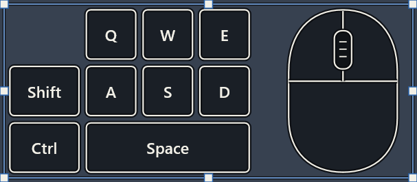

<p align="center">
  
</p>
<h1 align="center">Input Overlay Desktop</h1>
<p align="center"><strong>Your inputs. On your desktop.</strong><br>Compact keyboard + mouse HUD for Windows, without OBS.</p>
<p align="center">
  
  
  <a href="LICENSE"></a>
</p>

<p align="center"><a href="#installation">Install</a> &middot; <a href="#settings-and-usage">Customize</a> &middot; <a href="docs/TRAY_RELEASE.md">Test status</a> &middot; <a href="docs/LICENSING.md">Licensing</a></p>



A native desktop adaptation of [univrsal/input-overlay](https://github.com/univrsal/input-overlay), built with C++20, Win32 Raw Input, Direct2D and DirectWrite. This is an independent project under development.

- **Live input:** Q/W/E, Shift/A/S/D, Ctrl, Space, three mouse buttons and directional wheel indicators.
- **Desktop friendly:** transparent, click-through Locked mode; one-group moving and resizing in Edit mode.
- **Make it yours:** colors, fonts, opacity, layouts, scale and shortcuts in native Settings.
- **Tray first:** Settings, show/hide, startup and Exit without a console window.
- **Private by design:** current input state stays in memory; no typed-text recording, input history or telemetry.

## Installation

> **Release status:** public binary downloads are on hold while the exact compiler-runtime licence review is completed. Local review ZIPs are not approved releases. Build from source today; do not download binaries from untrusted mirrors. [Review checklist](docs/RELEASE_REVIEW.md).

### Portable setup: when an approved release is available

1. Open the repository's [Releases page](https://github.com/YiboMa2333/Input_Overlay_on_desktop/releases) and choose an approved **Windows x64 portable ZIP**. A published release is not currently promised.
2. Extract the entire ZIP into a permanent folder, such as `%LOCALAPPDATA%\Programs\InputOverlayDesktop`. Do not run it from inside the ZIP.
3. Double-click **InputOverlayDesktop.exe**. No OBS, Python, development environment, service or administrator installation is required at runtime.
4. Find the app icon in the notification area; check **Show hidden icons** if necessary. Double-click it to open **Settings**.
5. Choose **Edit Overlay** or press **Ctrl+Alt+F8**, move and resize your HUD, then choose **Lock Overlay** to restore click-through.

Keep the included licences, notices and corresponding-source archive with the application. Windows 10 version 1703 or newer / Windows 11 on x64 is the intended platform. Local GUI validation used Windows 11 at 150% display scaling; see the [test limitations](docs/TRAY_RELEASE.md).

### Start with Windows, update and uninstall

| Task | What to do |
| --- | --- |
| Start automatically | Enable **Start with Windows** in the tray menu, or enable it in Settings and Apply. Disabled by default; applies only to your Windows user. |
| Save preferences | Use **Apply** in Settings. Configuration is stored in `%LOCALAPPDATA%\InputOverlayDesktop\settings.ini`. |
| Recover a hidden HUD | Choose **Show Overlay**, then **Reset Position and Size** if needed. |
| Update | Exit from the tray, back up your settings, and replace the extracted application folder with the approved new package. Keep the same executable path if startup is enabled. |
| Move the application | Disable startup before moving it; re-enable startup at the new path. |
| Uninstall | Disable startup, choose **Exit**, then delete the extracted folder. Optionally remove the application's configuration folder. |

The executable is unsigned. Signing/SmartScreen approval is not provided. If launch fails, extract the whole package again and check the [installation and troubleshooting notes](docs/INSTALL.md). Closing Settings keeps the overlay running; **Exit** in the tray menu quits it completely.

## Build on Windows

Prerequisites: Windows 10 version 1703 or newer / Windows 11, Visual Studio 2022 with **Desktop development with C++**
(MSVC v143 and a Windows 10/11 SDK), and CMake 3.25 or newer on PATH. Use an
x64 Native Tools Command Prompt or Developer PowerShell. No third-party packages,
OBS SDK, submodules or network downloads are required by CMake.

```powershell
git clone https://github.com/YiboMa2333/Input_Overlay_on_desktop.git
cd Input_Overlay_on_desktop
# Use the standalone application development branch:
git switch develop/standalone-win32
cmake -S . -B build -G "Visual Studio 17 2022" -A x64
cmake --build build --config Release
.\build\Release\InputOverlayDesktop.exe
```

Run state, geometry, settings and packaging-policy tests (Python 3.9+ for packaging;
no third-party test framework):

```powershell
cmake --build build --config Release
ctest --test-dir build -C Release --output-on-failure
```

The state library and tests also build without Windows SDK dependencies on a
machine with CMake and a C++20 compiler:

```powershell
cmake -S . -B build/state -DOVERLAY_BUILD_APP=OFF -DBUILD_TESTING=ON
cmake --build build/state --config Release
ctest --test-dir build/state -C Release --output-on-failure
```

The native build and tests have also been run using portable
[LLVM-MinGW 20261104](https://github.com/mstorsjo/llvm-mingw/releases/tag/20261104)
(Clang 23.1.5) and CMake 4.5.0. With those tools extracted and CMake on PATH:

```powershell
$llvm = "C:/tools/llvm-mingw-20261104-ucrt-x86_64"
$env:PATH = "$llvm/bin;" + $env:PATH
cmake -S . -B build/llvm -G "MinGW Makefiles" `
  "-DCMAKE_CXX_COMPILER=$llvm/bin/clang++.exe" `
  "-DCMAKE_MAKE_PROGRAM=$llvm/bin/mingw32-make.exe" `
  -DCMAKE_BUILD_TYPE=Release "-DCMAKE_EXE_LINKER_FLAGS=-static"
cmake --build build/llvm -j 4
ctest --test-dir build/llvm --output-on-failure
.\build\llvm\InputOverlayDesktop.exe
```

Interactive desktop tests are opt-in: they open a temporary test backdrop and
move/click the pointer. They use an isolated settings directory and restart only
their own child application. Run while you are not interacting with the desktop:

```powershell
cmake -S . -B build -DOVERLAY_ENABLE_DESKTOP_TESTS=ON
cmake --build build --config Release
ctest --test-dir build -C Release --output-on-failure
```

Use `-B build/llvm` for the portable build. See [validation details](docs/VALIDATION.md).

If working from an existing checkout, start directly at the CMake commands.

Optional staging (not a source-compliant release archive by itself):

```powershell
cmake --install build --config Release --prefix build/package
```

For redistribution, include the matching complete source and build instructions
as described in [the licensing notes](docs/LICENSING.md).

## Settings and usage

The HUD starts **Locked**: topmost by default, transparent, fully
click-through (including visible key/mouse shapes), with no editing controls and
no keyboard focus activation from ordinary clicks. Visualization remains active.

Use the system tray menu **Edit Overlay** or **Ctrl+Alt+F8** to edit. A selection
rectangle with eight handles surrounds the entire keyboard/mouse group. Drag
anywhere inside to move it. Drag a corner to resize proportionally; labels,
spacing, outlines and the mouse all scale together. Handles show directional
cursors and resizing displays logical width/height. Escape cancels a drag.

Aspect ratio is locked to the original HUD by default. Uncheck **Settings > Lock
aspect ratio** for single-axis edge resizing; corner resizing still preserves
the current proportions. Hold Shift to force the original aspect ratio. Lock
again from the tray or shortcut to remove all selection controls and pass clicks
through. Edit mode may take focus when clicked so drag capture works reliably;
locking restores the prior foreground application when it remains available.

The tray menu provides **Edit Overlay**, **Lock Overlay**, **Reset Position and Size**,
**Open Settings**, **Show/Hide Overlay**, **Start with Windows**, and **Exit**. Reset returns the HUD to the primary work area at
its default size; it works even when the overlay is offscreen or locked. Explorer
restart is handled by recreating the tray icon. Startup fails visibly if the
recovery tray icon cannot be registered.

Double-click the tray icon or choose **Open Settings** for native Appearance, Layout and Behavior
tabs: color/font pickers, opacity, thickness, scale, spacing, per-key positioning
and visibility, three presets, mouse visibility, topmost, startup, launch-to-tray
and shortcut controls. Apply saves changes. See [customization and packaging](docs/CUSTOMIZATION.md)
for ranges, coverage and outstanding limitations.

Keys use thin white outlines, dark translucent fills and a warm yellow
`#D8CF45` pressed state. The mouse uses matching vector outlines. Dark edging
keeps white strokes visible on light desktops. All highlights read live state.
See [HUD rendering notes and previews](docs/HUD_DESIGN.md).

Position, logical size and mode are saved after completed edits, mode changes,
recovery and shutdown to `%LOCALAPPDATA%\InputOverlayDesktop\settings.ini`.
Prefer the settings window. You can also edit the INI while closed or use
**Settings > Reload configuration** after editing:

```ini
[window]
x=60
y=60
width=338
height=148
edit=0
aspect_lock=1
hotkey_enabled=1
hotkey_modifiers=3
hotkey_vk=119
```

Width accepts 32–6000 and height 24–4000 logical pixels at 96 DPI. Invalid values
fall back to defaults. Screen x/y are signed physical coordinates, so monitors
left/above the primary are supported. For 150% custom HUD size use width=507,
height=222; Windows DPI scaling is applied in addition. Unlocked edge resizing
uses nonuniform vector scaling. The legacy `topmost` key is ignored; the current
`always_on_top` preference is configurable and defaults to enabled.

The default shortcut uses modifier bitmask 3 (Ctrl=2, Alt=1, Shift=4) and key 119
(F8). Configuration accepts F1 through F11 with at least two Ctrl/Alt/Shift
modifiers; no bare gaming keys, Windows combinations or F12. Set
`hotkey_enabled=0` to disable it. Registration uses `MOD_NOREPEAT`; on conflict
the existing owner is retained, the tray reports shortcut unavailable, and tray
controls remain usable. A global shortcut reserves its configured combination;
choose another if your game/application uses it.

Partially offscreen positions are allowed while a useful portion remains
reachable. Restore and display/work-area changes validate against current monitor
work areas; inaccessible placements move onto the nearest available screen and
oversize geometry is reduced to fit. Reset Position is always available from the
tray. Mixed-DPI transitions end the current drag before applying the recommended
scaled bounds; start a new drag to continue on the new monitor.

Configuration write failures are reported in the tray tooltip/menu. No administrator rights are
required for ordinary desktop capture. Secure desktop, other sessions and
exclusive-input applications have not been validated.

## Architecture and upstream relationship

| Module | Responsibility |
| --- | --- |
| `src/input/raw_input.*` | Register keyboard/mouse Raw Input and normalize Windows events |
| `src/input/input_state.*` | Bounded held-state arrays, mouse position and wheel expiry |
| `src/render/renderer.*`, `hud_layout.hpp` | Vector HUD geometry, DirectWrite labels, alpha surface and visual state |
| `src/settings/settings.*` | Validated INI settings and position persistence |
| `src/settings/dialog.*`, `startup.hpp` | Native customization UI and current-user startup registration helper |
| `src/desktop/window.*` | HWND lifecycle, message loop, topmost policy and refresh timer |
| `src/desktop/geometry.hpp` | Handle hit testing, anchored resizing and monitor recovery without Win32 dependencies |
| `src/main.cpp` | DPI setup and application entry point |

All state mutation and drawing happen on the window thread; capture does not call
the renderer. A 33 ms timer redraws changed key/button/wheel state (approximately 30 FPS);
idle input and unused mouse-coordinate motion do not continually redraw.
Rendering recreates a lost Direct2D target. Capture unregisters on shutdown.
The adapter tracks physical scan-code locations, separately tracks each device,
and repairs missed releases. Shift and Ctrl combine left/right states visually.
See [INPUT_CAPTURE.md](docs/INPUT_CAPTURE.md) for interruption handling, privacy,
non-blocking registration and recovery limits.

`input_state.cpp` adapts upstream's `deps/common/input_data.cpp` event-to-state
dispatch logic. Its original copyright and GPL notice are retained. The remaining
modules are new Windows-specific scaffolding. Upstream's OBS graphics, Qt UI,
networking, libuiohook, SDL and preset assets are excluded. See the pinned
[repository and reuse audit](docs/UPSTREAM_AUDIT.md).

## Licence

The standalone application is **GPL-2.0-only**, not MIT-only. See [LICENSE](LICENSE),
[LICENSES](LICENSES) and [licensing obligations](docs/LICENSING.md). The MIT notice
from the original repository is preserved in `LICENSES/MIT.txt`; it does not
relicense the GPL adaptation. This is an independent adaptation, not an official
upstream release.

## Validation and remaining work

See [tray and portable verification](docs/TRAY_RELEASE.md) for notification-area
controls, single-instance behavior, the actual Explorer-restart result and the
remaining manual tray check.

The Release application was built and launched on Windows using portable
LLVM-MinGW/CMake. State, placement, settings and real desktop integration tests
passed, including cross-process click-through, drag/resize, restart persistence,
hotkeys and recovery notifications. See [VALIDATION.md](docs/VALIDATION.md) for
the exact scope, tool versions and remaining hardware checks.

Private release-review staging can now be assembled with the executable, notices,
dependency/source manifest and matching source ZIP. Distributable ZIPs and CI
binary uploads remain blocked by the licence/runtime review hold. See
[release review](docs/RELEASE_REVIEW.md) and [installation](docs/INSTALL.md).
The [Windows x64 Actions workflow](.github/workflows/windows-x64.yml) builds and
tests without uploading binaries during normal push/PR runs.

Remaining work includes upstream preset conversion with asset clearance and gamepad support. Physical monitor unplugging,
mixed-DPI monitor transitions, exclusive full-screen games and MSVC compilation
still require separate validation. GitHub Actions is added but has not run
remotely; actual logon startup and broader performance benchmarks remain untested. Very fast
press/release pairs between paints may not be visible.
Horizontal wheel input is not implemented. Devices already held when capture
starts are not seeded into state. A device disconnect while held can leave stale
state if Windows fails to report both device removal and a usable asynchronous
release state.
