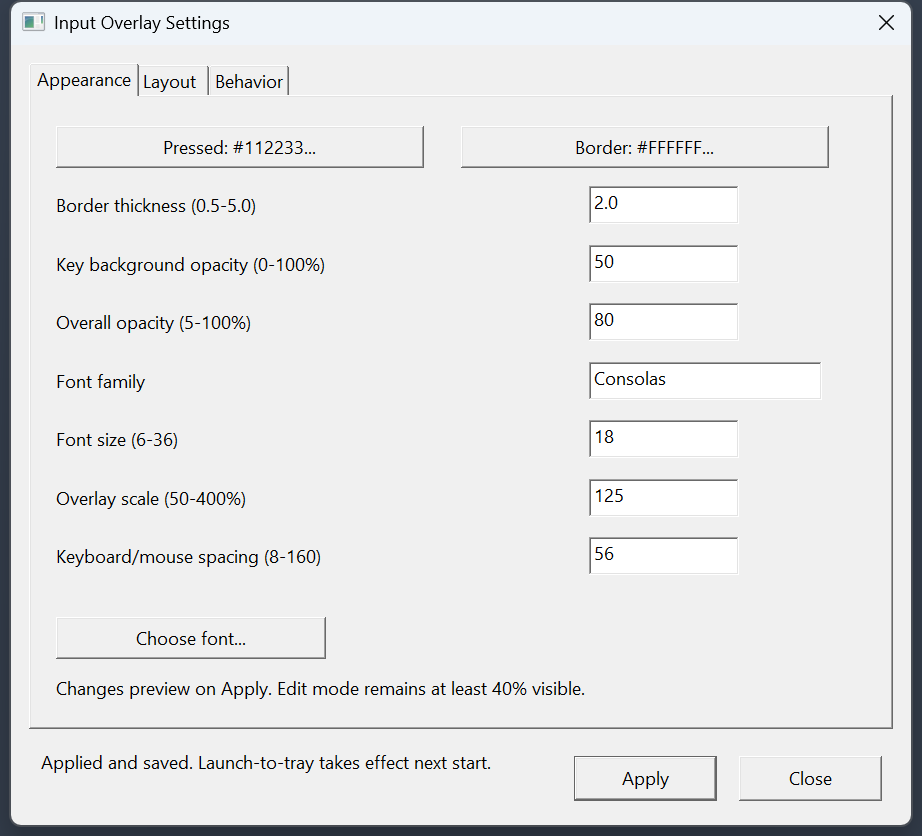

# Customization and packaging

Open **tray > Settings > Customize overlay**. The native modeless settings window
has three tabs. Edit values, then press **Apply** to update and save; Close discards
unapplied changes. It is intentionally interactive even when the HUD is locked.



## Appearance

| Control | Default / range |
| --- | --- |
| Pressed color | Native RGB color picker, yellow `#D8CF45` |
| Border color | Native color picker, white `#FFFFFF`; labels follow this color |
| Border thickness | 1.2 units; 0.5-5.0, stored in tenths |
| Key background opacity | 74%; 0-100% (also applies to idle mouse body) |
| Overall HUD opacity | 100%; 5-100%; edit mode keeps at least 40% visibility for recovery controls |
| Label font | Segoe UI Semibold; installed family picker or family name |
| Label font size | 13 logical HUD units; 6-36; native font dialog converts points to these units |
| Overlay scale | 100%; 50-400%, in addition to Windows DPI scaling |
| Keyboard/mouse spacing | 32 units; 8-160 |

Geometry, labels and borders scale together. Pressed text uses light/dark contrast
based on the chosen fill. Extremely large font choices can clip within a small
cap; the family/size can be adjusted after viewing Apply. Unknown font families
use DirectWrite fallback; no font files are bundled.

## Layout

Presets are Compact gaming, WASD + modifiers and Single row. Selecting a preset
replaces the current arrangement; subsequent edits are stored as overrides.
For each of the nine existing logical keys, select it, enable/disable it and set
its X/Y position. Coordinates are logical HUD units, X 8-1000 and Y 8-600. Select
another key to edit the next one; Apply stores them all. Overlap is allowed for
intentional arrangements. Physical key bindings and cap widths remain fixed.

Show/hide the mouse diagram, or Reset layout to default without resetting colors
and behavior. Canvas extent and mouse placement follow enabled keys and spacing.
If all keys and the mouse are disabled in malformed configuration, W is re-enabled
to retain an editable object. This version does not add arbitrary key bindings,
import upstream textures or provide in-HUD drag-to-rearrange of individual caps.

## Behavior

- Always-on-top and Edit/Locked controls apply immediately on Apply. Disabling
  topmost changes only Z-order; Locked still passes clicks through and avoids
  ordinary focus activation.
- Start with Windows registers/removes only `InputOverlayDesktop` under the
  current user's `Software\Microsoft\Windows\CurrentVersion\Run`. The executable
  path is quoted and startup uses `--tray`. No administrator rights are requested.
  Registration is changed only when the user changes this toggle and applies it,
  never merely by loading a configuration file. Keep the executable at its path.
  Windows/Task Manager policy can still disable or delay startup.
- Launch hidden to tray takes effect next start. Edit/Lock from the tray or the
  edit shortcut reveals it. The application always has an Exit tray command.
- The shortcut combines Ctrl/Alt/Shift with F1-F11 and requires at least two
  modifiers. Conflict leaves the other owner working and reports unavailable.
- Reset position/size is queued until Apply and uses the current layout at 100%
  on the primary work area. Existing PowerPoint-style handles remain available.

## Storage and rendering

All preferences and geometry live in
`%LOCALAPPDATA%\InputOverlayDesktop\settings.ini`. Values are bounded and parsed
with overflow/malformed checks. Colors are stored as decimal `0xRRGGBB` values,
font names are length-checked, layouts cannot become empty, and invalid shortcuts
are disabled. Advanced geometry accepts width 32-6000 and height 24-4000 logical
pixels, supporting a 50% mouse-free row. GUI scale/layout changes compute their
own extent; position and nonuniform edit resizing are preserved when applicable.

Input capture and state remain separate from settings/rendering. A 33 ms timer
caps ordinary state updates at approximately 30 FPS. Changes to tracked key,
button and wheel state request input repaints; mouse motion alone does not redraw an unused coordinate
display. Drag/resize/settings/exposure still redraw when needed. A lost target
requests a retry rather than leaving a dirty-driven surface blank. No text/history
recording or network transmission is added. CPU/private-memory performance has
not been benchmarked across hardware; very large layouts/scales cost more memory.
Hidden configured keys may still request a capped repaint. The settings window
has a fixed logical size; very small work areas at extreme DPI can clip it.

## Tests actually run

- Windows x64 Release build using LLVM-MinGW, five CTest targets.
- Validation/persistence for colors, font, opacity, scale, per-key position and
  visibility, presets, nonempty layouts and malformed values.
- Small mouse-free single-row geometry restores at 50% scale.
- Native settings window at DPI 144, color picker RGB selection and Apply,
  font picker opening/cancel, font family/size editing, tab navigation, layout
  edits/reset, repeated Apply after resetting geometry, topmost off while retaining locked click-through, restart and
  launch-to-tray/reveal. Font picker selection beyond opening/cancel was not
  separately automated; native family/size edits were applied and saved.
- Startup helper add/read/remove and quoted-path validation in an isolated test
  registry key. The real Run key and actual logon were not modified/tested.
- Existing input-state, placement, real click-through, recovery and shortcut
  tests continue to pass. Color chooser automation uses actual edit-character
  notifications; cross-process caption setters do not exercise its edit logic.
- Release gate rejection, source/toolchain binding, malformed PE rejection and
  actual x64 dependency audit. Private staging was assembled; no approved binary
  release ZIP was created or uploaded.

Only one physical display is available, at 150% DPI. Mixed-DPI transitions and
physical monitor removal remain untested by the user's earlier decision. The
GitHub Actions MSVC build, headless tests and staging have since passed; see RELEASE_REVIEW.md for the approved LLVM portable route. Actual startup at
logon, signing/SmartScreen and a broad performance/accessibility matrix remain
manual work. See VALIDATION and RELEASE_REVIEW for precise scope.

## Packaging commands

Requires Python 3.9+ and CMake. For a private review folder (never uploaded by CI):

```powershell
python tools/package.py stage --build build --output build/review --toolchain msvc-static
```

For the locally tested LLVM route, use `--build build/llvm` and
`--toolchain llvm-mingw-static`. Add `--cmake <path-to-cmake.exe>` if necessary.
Output must be new/empty, avoiding stale files. The stage contains executable,
notices, documentation, `BUILD_MANIFEST.json`, matching source ZIP and a private
review marker. PE32+ imports, including delay imports, must be Windows system
libraries; an unexpected runtime DLL blocks packaging rather than being omitted.

Distributable ZIP creation is gated:

```powershell
python tools/package.py release --build build --output build/distribution --toolchain msvc-static
```

This currently fails deliberately. Follow [RELEASE_REVIEW.md](RELEASE_REVIEW.md)
to check exact runtime compatibility and bind a named approval to the source
digest and toolchain. No approval has been granted. The Actions workflow builds
x64 static-CRT binaries, runs noninteractive tests and validates private staging.
Only a manual main-branch run requesting a package can attempt ZIP upload, and
that step must first pass the same release gate. There is no GitHub Release
publication action. See [installation instructions](INSTALL.md).
