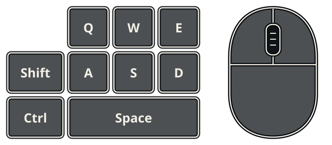
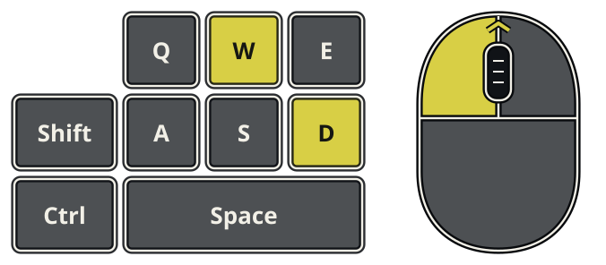

# Compact desktop HUD

The requested reference attachment was not accessible in the conversation or
workspace. This implementation follows the written layout and palette; exact
shape/proportion matching against that screenshot remains pending its availability.

## Vector appearance

The design canvas is 338 by 148 logical units. Q/W/E align with A/S/D; a wider
Shift key sits to their left. Ctrl sits below Shift, and a wide Space spans the
three letter columns. Key gaps are 6 units. A 132-unit-high curved mouse sits
to the right, aligned with the top and bottom key edges. No screen-sized or
group-sized background rectangle is drawn.

- Key corner radius: 3.5 units. Main outline: 1.2 units, `#F2F0E7`.
- Dark outside edging: 3.6 units, `#080A0D` at 85% alpha for light backgrounds.
- Idle fill: `#101317` at 74% alpha; pressed fill: opaque `#D8CF45`.
- Centered Segoe UI Semibold labels: 13 units, off-white when idle and dark when
  pressed. No font files, textures or upstream assets are bundled.
- Left/right mouse top halves read button states 0/1. The separate wheel capsule
  reads middle-button state 2, with opaque dark backing so adjacent yellow regions
  do not bleed into it. Wheel movement shows an up/down yellow chevron until the
  input model's 180 ms pulse expires. X1/X2 are captured but not visualized.

The same state snapshot feeds all shapes; multiple keys and mouse regions can
light together. There is no text-event popup, input history or decorative animation
unrelated to actual state.

## Transparency and DPI

`Renderer` draws using a Direct2D DC render target bound to a top-down 32-bit BGRA
DIB. Its alpha mode is premultiplied. Each frame clears to zero alpha, draws only
the HUD vectors/text, then presents through `UpdateLayeredWindow` with
`ULW_ALPHA` and `AC_SRC_ALPHA`. There is no color-key transparency, screenshot
texture or opaque HWND render-target clear. The GDI bitmap, selected object and
memory DC are released with the target on size changes and destruction.

The target uses 96 DPI drawing coordinates and a uniform physical-pixel transform
from `hud::fit`; labels and curves scale with geometry without stretching. The
process requests Per Monitor V2 awareness before creating windows. Initial size
uses `GetDpiForWindow`; `WM_DPICHANGED` applies the recommended bounds, invalidates
the surface and redraws. Settings dimensions are logical units. DirectWrite uses
grayscale antialiasing for alpha composition, avoiding ClearType color fringes.

The HWND is a layered, non-activating popup/tool window, topmost by default.
Fully transparent pixels pass through to the desktop. Hit testing treats visible
keys and mouse as draggable caption regions and explicit gaps as transparent.
Right-clicking an element opens a close menu. This provides controls without a
title bar; full click-through of visible shapes is intentionally not enabled.

## Design previews (not native screenshots)

Generate again with `python tools/preview_hud.py`. This package-free documentation
tool reads key rectangles from the production header and mirrors mouse paths;
the SVGs are not runtime assets and are not evidence that Windows rendering works.
SVG text rasterization can differ from DirectWrite.

The generator ran successfully and parsed both SVGs as XML. Native application
screenshots could not be captured because no Windows executable can be built in
the current environment. C++ tests, Direct2D composition, DPI transitions and
desktop hit-testing remain unexecuted. See the visual checks in `VALIDATION.md`.

Implementation references: [Direct2D alpha formats](https://learn.microsoft.com/en-us/windows/win32/direct2d/supported-pixel-formats-and-alpha-modes),
[layered-window composition](https://learn.microsoft.com/en-us/windows/win32/api/winuser/nf-winuser-updatelayeredwindow),
[per-monitor DPI changes](https://learn.microsoft.com/en-us/windows/win32/hidpi/wm-dpichanged).
