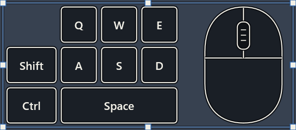
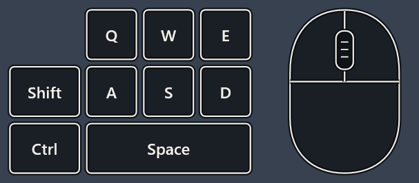

# Positioning and resizing

## Controls

- **Locked** is the default. The HUD is topmost over ordinary desktop windows,
  all pixels pass clicks through, no selection chrome is drawn, and ordinary
  clicks do not activate the overlay. Input visualization remains active.
- **Edit** selects the keyboard and mouse as one object. Drag anywhere inside
  the selection (including gaps) to move it. Eight handles provide four corner
  and four midpoint resize targets; the cursor shows the active resize direction.
  The opposite corner/edge stays anchored. Width/height in logical pixels appear
  during resize. Escape cancels; releasing the pointer completes and saves.
- Corner resizing preserves proportions by default. **Settings > Lock aspect
  ratio** (on initially) constrains all resize handles to the original 338:148
  ratio. With it off, edge handles change only their axis and corners preserve
  the starting proportions. Shift always forces the original ratio. Resizing
  cannot flip the object or go below its minimum size.
- Tray menu: **Edit Overlay**, **Lock Overlay**, **Reset Position**, **Settings**,
  **Exit**. Right-clicking in edit mode opens the same menu. The tray remains
  available when locked or offscreen. Settings includes aspect lock, configuration
  editing/reload, shortcut availability and configuration-write status.
- Default global toggle: **Ctrl+Alt+F8**. It can be changed/disabled in INI;
  numeric modifier/key rules are documented in README. Repeating the key does
  not repeatedly toggle. A registration conflict leaves the other owner working
  and reports the shortcut unavailable; use the tray or change the INI.

## Native implementation

`desktop/geometry.hpp` contains platform-independent handle hit tests, anchored
resize math, size constraints and screen recovery. `Window` owns the mode, mouse
capture gesture, DPI/monitor messages, tray and shortcut. `Renderer` draws the HUD
and selection chrome from those states. Input capture remains independent.

Locked mode combines the layered window's `WS_EX_TRANSPARENT` hit-test behavior,
`WS_EX_NOACTIVATE`, `HTTRANSPARENT` and `MA_NOACTIVATE`. The transparent background
alone does not make painted keys click-through, and `HTTRANSPARENT` alone is not
a cross-process forwarding mechanism. The integration test probes a painted key
before and after locking and sends a real click to a different-process backdrop.
No synthetic forwarding of intercepted application clicks is used in production.

Edit mode removes transparent/non-activating styles and returns `HTCLIENT` for
the rectangular object. A 1/255 alpha fill makes gaps within the selection
interactive. Left press acquires capture; screen-coordinate deltas update the
whole window. Mouse-up or capture loss completes, Escape/cancel restores the
starting bounds, and switching mode ends any active gesture. Edit clicks may
activate the HUD for reliable capture; locking attempts to restore the previous
foreground window if it still exists. Tray menu activation is explicitly user-driven.

HUD geometry, strokes and labels use the same X/Y transform. Fixed-DPI editing
chrome is rendered after resetting the HUD transform so handles remain usable
at large/small HUD scales. Shift is queried during the drag. A per-monitor DPI
change ends the current gesture, applies Windows' suggested rectangle, recreates
the pixel surface and persists the new logical size; the user may drag again.

## Persistence and recovery

`settings.ini` stores signed physical x/y, logical width/height, edit mode,
aspect lock and shortcut configuration. Numeric parsing rejects overflow and
malformed/out-of-range values. Logical dimensions restore through the destination
window's DPI. Geometry is saved on completed gestures, mode changes, reset,
recovery and clean exit. Write failures are visible in tray status.

Negative coordinates and partial offscreen placement are valid. At least a
48-by-32 pixel portion must intersect one current work area (or the full smaller
dimension for very small geometry). If none does, recovery chooses the nearest
work area, scales oversized geometry down to fit and clamps it within that area.
This runs at startup, after completed moves and on display/work-area changes.
Reset Position returns default-sized geometry to the primary work area. Explorer
restart re-adds the tray icon, with timer retries if Shell is not ready.

Shortcut, tray icon, timer, session notifications, input registration and mouse
capture are released by their lifecycle paths; tests confirm graceful process
exit and that another process can register the shortcut after exit.

## Native appearance

These are captures of the real Windows executable over the test backdrop, not
SVG mockups. The backdrop color is visible through the transparent gaps.

## Verification boundary

The Windows automated test passed real movement, corner and edge resizing,
Shift locking, cross-process click-through/focus, shortcut toggles/conflicts,
restart persistence, tray registration/reset and simulated display-change recovery.
The geometry suite also models negative-coordinate monitors, removal of a screen
and resolution reduction. Physical cable unplugging and mixed-DPI monitor moves
have not been exercised; those are still manual hardware checks. Shell menu
commands are dispatched through their real WM_COMMAND handlers by the test;
opening/selecting every tray menu item by pointer remains a manual check.
The native suite requires an idle shared desktop; interference was observed on
some reruns. The final idle run passed. See `VALIDATION.md` for the full record.

Win32 references: [layered-window hit testing](https://learn.microsoft.com/en-us/windows/win32/winmsg/window-features#layered-windows),
[RegisterHotKey behavior](https://learn.microsoft.com/en-us/windows/win32/api/winuser/nf-winuser-registerhotkey).
